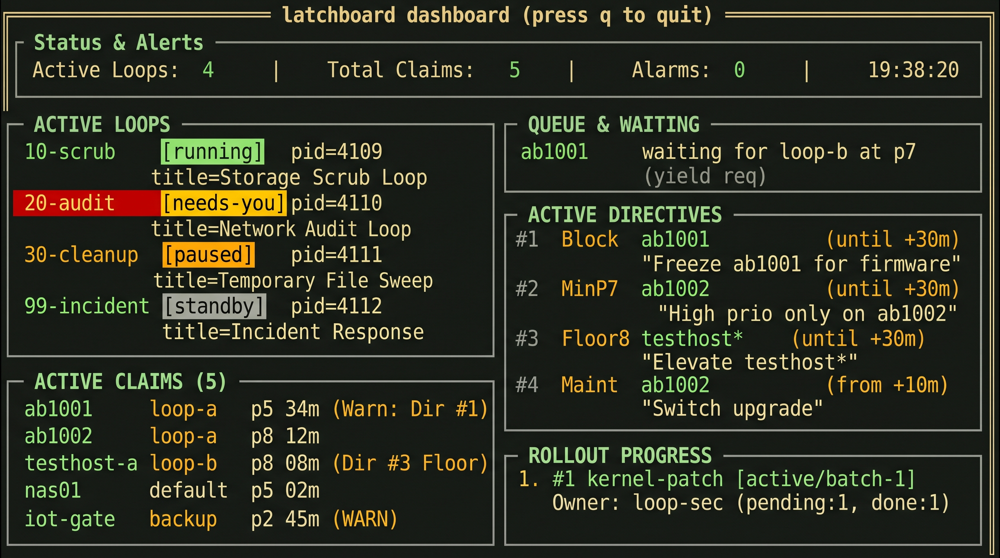

# latchboard

Node claims, priorities and agent "loops" for a homelab, so that several
autonomous CLI agent sessions can work on the same machines without stepping
on each other.

If you run more than one agent session (for example [Claude Code](https://claude.com/claude-code))
against a shared set of hosts, two of them will eventually `ssh` into the same
box at the same time. latchboard makes that a managed situation instead of a
race: a session must *claim* a node before touching it, waiters queue by
priority, idle claims are released automatically, and an operator can issue
directives (block, warn, reserve, pause) that every session obeys.

## What's in the box

| Component | Language | What it does |
|---|---|---|
| `latchd` | Rust + SQLite | Claim/queue/take-grant store, directive checks, idle sweeper (`latchd daemon`) |
| `latch-run` | Rust | Runs one loop file as an agent session in a PTY, with a control socket and restart-on-change |
| `latch-up` | Rust | Starts, stops, pauses and ticks loops (`latch-up start all`, `latch-up status`) |
| `latch-note` | Python 3 (stdlib only) | Session notes, heartbeats, directives, maintenance windows, rollouts, advisory feeds, and the Claude Code hooks |
| `dashboard/` | Rust + ratatui | Terminal snapshot of claims, rollouts and runners (`--once` for plain text) |

See [OVERVIEW.md](OVERVIEW.md) for how the pieces fit together.

## Requirements

- A Unix-like OS (uses Unix sockets, PTYs and `kill(2)`)
- Rust stable, **1.78 or newer** (the lockfiles are format version 4)
- Python 3.9+ (standard library only)
- bash

## Build, test, install

```bash
./tests/run.sh        # builds the workspace and runs tests/suites/*.sh
./install.sh all      # release build -> ~/.local/bin (latchd, latch-run, latch-up)
./manage.sh install   # copies latch-note and config/common.md into place
./manage.sh hooks     # merges hooks/claude-hooks.json into ~/.claude/settings.json
```

`install.sh` runs the tests first; set `LATCH_SKIP_TESTS=1` to skip them.
Existing binaries are backed up as `<name>.bak-<timestamp>` (the two newest are
kept; `touch <backup>.keep` pins one). The dashboard is a separate cargo
project: see [INSTALL.md](INSTALL.md).

## Quick tour

```bash
# Claim a node at priority 5, see who holds what
latchd claim ab1001 --holder loop-a -p 5
latchd status

# A higher-priority session queues behind it; the sweeper logs a yield request
latchd wait ab1001 --waiter loop-b -p 8
latchd sweep

# Operator directive: block every node matching ab10* for the next hour
latch-note directive "ZFS resilver in progress" 'ab10*' --until +1h --block
```

Claims are idle-swept: warned after 45 minutes without use, released 10
minutes after the warning. A queued waiter gains +1 effective priority per
30 minutes (capped at +2), and a yield is requested when a waiter outranks the
holder by 2 or more.

## Loops

A loop is a Markdown file with `key: value` headers, a `---` line, then the
prompt the agent receives on each tick:

```
title: Storage Scrub Loop
every: 15m
restart_on: crash, upgrade, change
agent_args: --quiet
---
Check ZFS pool health and SMART counters on storage nodes.
```

Samples are in [`examples/`](examples/). The agent command defaults to
`claude`; set `LATCH_AGENT_BIN` (or a `runner:` header) to use another CLI.
Shared rules for every loop live in `~/.config/latchboard/common.md`
(source: [`config/common.md`](config/common.md)); editing it restarts running
loops that opted into `change`.

## Configuration

| Variable | Default | Purpose |
|---|---|---|
| `LATCHD_DIR` | `~/.local/state/latchd` | `claims.db` and `events.jsonl` |
| `LATCHBOARD_STATE_DIR` | `~/.local/state/latchboard` | Runner sockets and state |
| `LATCH_HANDOVER_DIR` | `~/.local/state/morning-startup` | Directives, peers, notices |
| `LATCHBOARD_CONFIG` / `LATCHD_CONFIG` | `~/.config/latchboard` / `~/.config/latchd` | `nodes`, `loops/`, `common.md` |
| `LATCH_AGENT_BIN` | `claude` | Agent executable the runner launches |

## Status

Early (`latchd` 0.3.x).

## License

[MIT](LICENSE)

## Dashboard Overview


